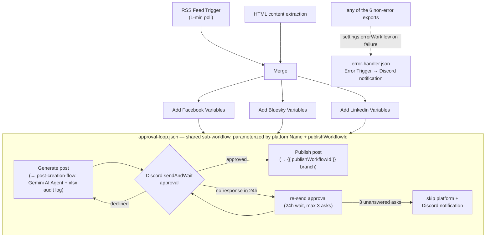
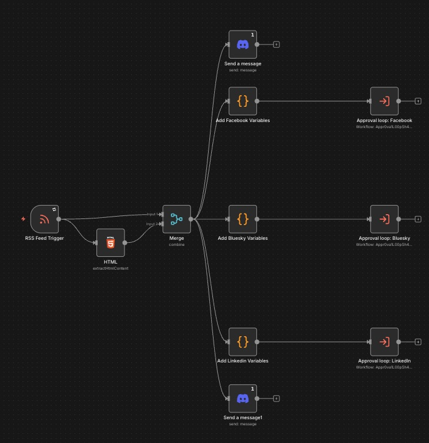
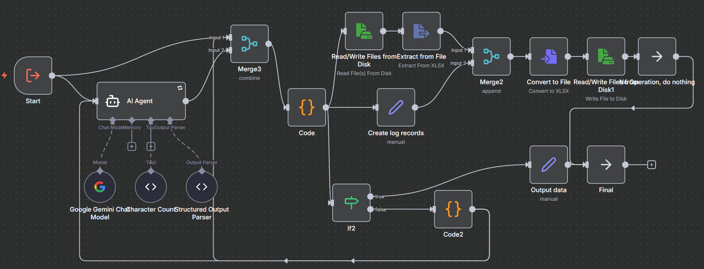
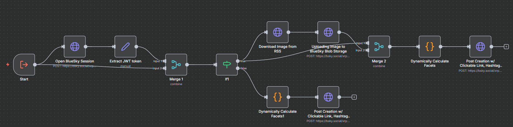
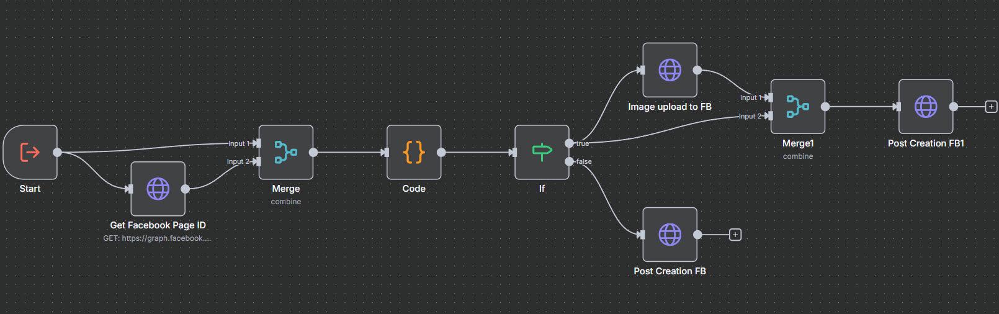
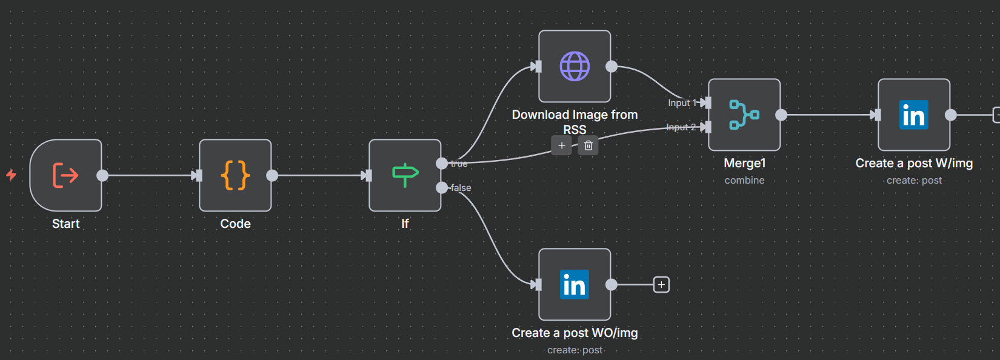

# FirstAIMovers: RSS to Multi-Social with Human-in-the-Loop Approval

[](https://github.com/mahmoudhaytham25/rss-social-automation-hitl/actions/workflows/ci.yml)
[](LICENSE)


## Situation
First AI Movers aims to automate the process of distributing human-approved RSS feed updates to multiple social media platforms (Bluesky, Facebook, and LinkedIn) with AI-powered content optimization. Each platform requires different formatting, character limits, and specific features like Bluesky's facets for clickable links. This project leverages n8n to create a modular workflow that transforms RSS content using Google Gemini and posts platform-optimized versions.

---

## Task
The goal is to build an automated workflow that does the following in order:
1. Monitor an RSS feed for new items
2. Use AI/LLM to transform the content of the new item into platform-specific posts
3. Ask for human approval on each platform's post
4. If approved, post the content to the platform. Otherwise, re-generate the post again and ask for approval
5. Modular design must be adopted for ease of adding new platforms later on 

---

## Action
An n8n workflow was created with the following architecture:

RSS Feed -> Content extraction -> Platform-specific branching -> LLM post generation -> Platform posting module -> Post publishing

---

### Steps:
1. The RSS feed item content is extracted, including the following: 
    - Item title
    - Link
    - Image URL (if present)
    - Paragraphs from item page
2. Extracted content is passed once to each platform-specific branch
    - Facebook
    - Bluesky
    - LinkedIn
3. Platform-specific variables are added to the content:
    - System prompt
    - User prompt
    - Branch name
    - Character limit for platform post
4. Item content + platform-specific variables are passed to the **post creation sub-workflow**, which is responsible for the following:
    - Generating post content for each branch by summarizing the paragraph content in a way that appeals to the platform's audience while sticking to the character limit.
    - Logging the generated content to an Excel file for auditing if needed
5. Human-in-the-loop approval request is sent using a Discord bot to a dedicated Discord channel in a Discord server for the human to approve.
    - If **approved**, we move onto step 6 
    - If **declined**, we go back to step 4 and repeat until human approved.
6. Platform-specific publishing sub-workflow is called

---

## Architecture



---

## Result
The automated workflow functions correctly:

- Monitors the RSS feed for new items with 1-minute polling (configurable via the RSS Feed Trigger node in `main.json`).
- Transforms RSS content using AI to create platform-optimized versions.
- Posts to all three platforms simultaneously with:
    - Bluesky: Clickable links using facets, hashtags, and embedded external content.
    - Facebook: Native posts with uploaded images and longer descriptive content.
    - LinkedIn: Posts with uploaded images and much larger content that caters to LinkedIn audience (2000+ characters).
- Ensures modular architecture for easy addition of future platforms ( Twitter, Mastodon, etc.).
- Maintains consistent branding with #FirstAIMovers hashtag across platforms.

---

## Getting started

Prerequisites: Docker with the Compose plugin, or an existing n8n **≥ 1.75**.

```bash
cp .env.example .env          # set N8N_ENCRYPTION_KEY, WEBHOOK_URL, timezone
docker compose up -d          # n8n on http://localhost:5678
```

Import all seven workflows with their ids preserved (order matters — sub-workflows and the error handler before `main.json`, whose `executeWorkflow` nodes and `settings.errorWorkflow` reference them by id):

```bash
for f in error-handler post-creation-flow bluesky-branch facebook-branch linkedin-branch approval-loop main; do
  docker compose exec n8n n8n import:workflow --input="/files/workflows/${f}.json"
done
```

Then create the five credentials (Gemini API key, Discord OAuth2, Facebook Page token, Bluesky custom auth, LinkedIn OAuth2), update the environment-specific values, and activate `main.json`'s workflow **last** — its RSS trigger starts polling on activation. Full walkthrough: **[docs/setup.md](docs/setup.md)**.

## Workflow Files

All n8n workflow exports live in [`workflows/`](workflows/):

| File | Purpose |
|------|---------|
| `main.json` | RSS trigger → content extraction → per-platform variables → shared approval loop |
| `post-creation-flow.json` | Shared sub-workflow: LLM post generation + audit logging |
| `approval-loop.json` | Shared sub-workflow: Discord approval → publish/regenerate/re-ask/skip; publishes via the item's `publishWorkflowId` |
| `bluesky-branch.json` | Bluesky publishing (ATProto auth, facets, image blobs) |
| `facebook-branch.json` | Facebook publishing (Graph API, image upload) |
| `linkedin-branch.json` | LinkedIn publishing |
| `error-handler.json` | Error Trigger → Discord notification, wired via `settings.errorWorkflow` in every export |

Exports ship `active: false` and without `meta`/`versionId` — re-exports are cleaned by [`scripts/normalize-exports.py`](scripts/normalize-exports.py). A pinned local n8n runs via [`docker-compose.yml`](docker-compose.yml) + [`.env.example`](.env.example); see [docs/setup.md](docs/setup.md) for the full import/credential runbook.

## Screenshots

| Main workflow | Post creation |
|---|---|
|  |  |

| Bluesky | Facebook | LinkedIn |
|---|---|---|
|  |  |  |

## Extras

- [Setup runbook](docs/setup.md) — Docker Compose quickstart, id-preserving CLI import, the five-credential matrix, and environment-specific values to replace.
- [Exposing n8n approvals to other devices with ngrok](docs/ngrok-approval-setup.md) — needed if approving posts from your phone while self-hosting n8n locally.
- [`tests/`](tests/) — a pytest suite that validates the workflow exports (wiring, field references, secrets scan). More rigor than an n8n repo needs; see [tests/README.md](tests/README.md) for why it exists.

## Notes

- **Audit log path is environment-specific:** `post-creation-flow.json` reads and writes the Excel audit log at `/n8n/data/FirstAIMoversP3.xlsx` (the "Read/Write Files from Disk" nodes). Update this path to a location that exists in your n8n instance. If the file is missing, the read node is configured to skip audit logging (`onError: continueErrorOutput`) rather than fail the run.
- **Regeneration cap:** if generated content exceeds the platform character limit, the post-creation sub-workflow retries the LLM at most 3 times (`attempts` counter incremented in "Code2", checked in "If2") before returning the last generated output.

**Reliability notes:**

- **Approval timeout / re-ask policy:** each Discord `sendAndWait` approval waits up to 24 h (`limitWaitTime`); on timeout the approval is re-sent, up to 3 unanswered asks per platform — after that the platform is skipped for the item and a Discord notification is posted. Declines still regenerate the post.
- **Retry policy:** read/upload HTTP nodes retry 3 times with 1 s waits; publish calls are deliberately **not** retried, to avoid duplicate posts.
- **Error workflow:** every export references `error-handler.json` via `settings.errorWorkflow` — a failed execution posts a Discord notification instead of failing silently.

---

## References
- [n8n Documentation](https://docs.n8n.io/)
- [Discord App Documentation](https://discord.com/developers/docs/intro)
- [Facebook Graph API Documentation](https://developers.facebook.com/docs/graph-api/)
- [Bluesky Facets API Documentation](https://docs.bsky.app/docs/advanced-guides/post-richtext)
- [N8n LinkedIn Credentials Documentation](https://docs.n8n.io/integrations/builtin/credentials/linkedin/)

