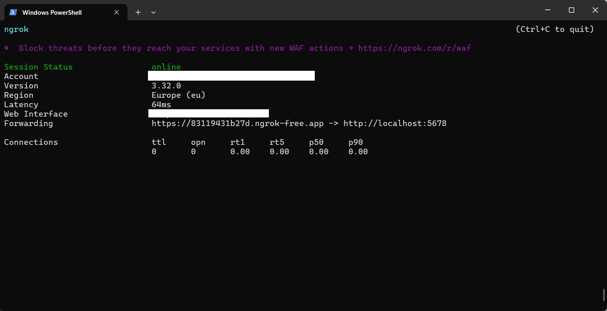
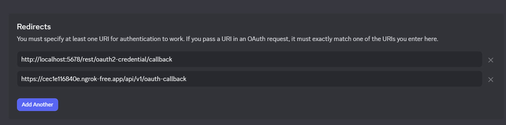

# Exposing n8n Approvals to Other Devices with ngrok

When self-hosting n8n locally, approval links default to `localhost` and only work on your device. This guide shows you how to expose your approval workflows to other devices using ngrok.

## Prerequisites

- n8n running locally on your machine
- [ngrok installed](https://ngrok.com/download)
- Discord bot application created in the [Discord Developer Portal](https://discord.com/developers/applications/)

## Step 1: Start an ngrok Tunnel

Open a terminal or PowerShell and run:

```bash
ngrok http 5678
```

You'll see output similar to this:

```
Forwarding                    https://cec1e116840e.ngrok-free.app -> http://localhost:5678
```



Copy the forwarding URL (the `https://...` part). Keep this terminal window open—closing it will stop your tunnel.

**Note:** Free ngrok URLs are temporary and change each time you restart. If you're using this for production, consider a paid ngrok account for a static URL.

## Step 2: Update Discord OAuth2 Redirect URI

1. Go to the [Discord Developer Portal](https://discord.com/developers/applications/)
2. Select your n8n application
3. Navigate to **OAuth2 → Redirects**
4. Add your ngrok URL with the callback path:
   ```
   https://cec1e116840e.ngrok-free.app/api/v1/oauth-callback
   ```
   (Replace `cec1e116840e.ngrok-free.app` with your actual ngrok URL)
5. Click **Save Changes**



## Step 3: Set n8n Environment Variable

Stop your n8n instance (if running) and restart it with the `WEBHOOK_URL` environment variable set to your ngrok URL.

**PowerShell:**
```powershell
$env:WEBHOOK_URL="https://cec1e116840e.ngrok-free.app"
n8n start
```

**Bash/Terminal:**
```bash
export WEBHOOK_URL="https://cec1e116840e.ngrok-free.app"
n8n start
```

Replace `cec1e116840e.ngrok-free.app` with your actual ngrok URL.

## Verification

Open your n8n workflow and trigger an approval. The approval link should now point to your ngrok URL instead of `localhost`. Clicking the link from any device should now work correctly.

## For Production Use

If you're running this workflow permanently:

- **Upgrade to paid ngrok:** Get a static URL that doesn't change on restart
- **Use a permanent domain:** Point a custom domain to your n8n instance
- **Host in the cloud:** Deploy n8n to a cloud provider (AWS, DigitalOcean, Heroku, etc.)

With a static URL, you only need to configure Discord once and can skip the setup after each restart.

## Troubleshooting

**Still seeing localhost in approval links?**
- Verify `WEBHOOK_URL` is set correctly before starting n8n
- Check that n8n logs show the correct URL on startup
- Clear your browser cache and try again

**ngrok connection refused?**
- Make sure n8n is running on port 5678
- Verify ngrok tunnel is still active in the other terminal window